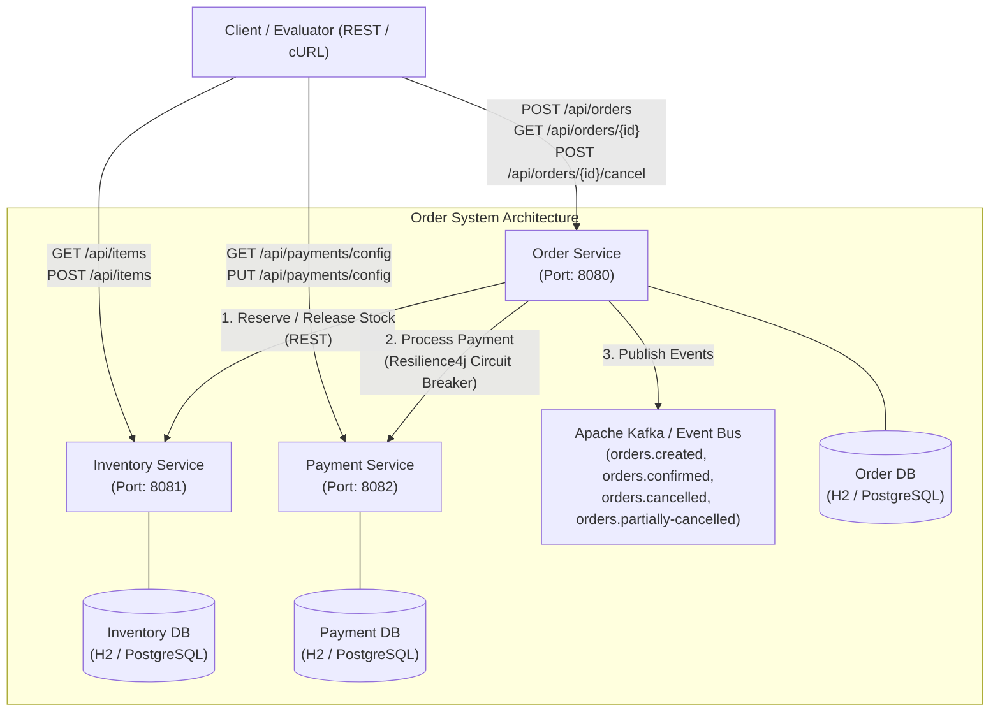
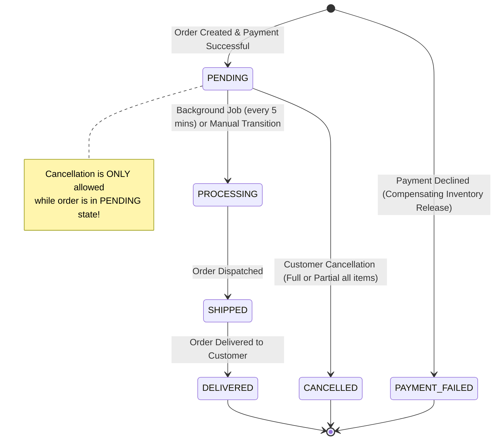
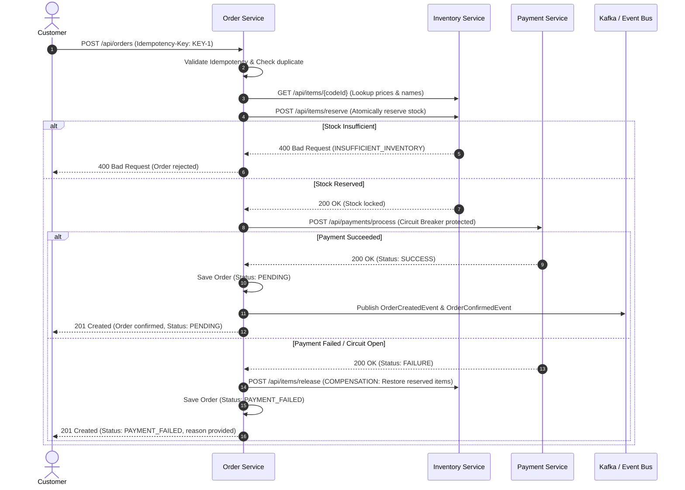
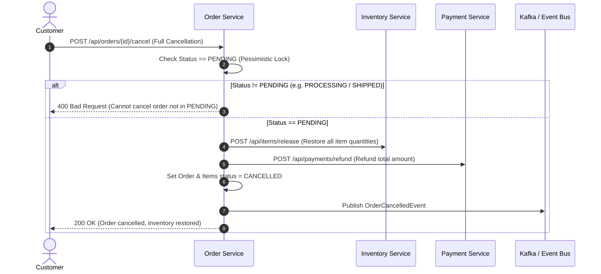

# System Architecture — E-Commerce Order Processing System

## 1. System Overview

The **Order Processing System** is a distributed, event-driven, microservices-based backend designed for high concurrency, fault tolerance, data consistency, and clear bounded contexts. It is built using Java 21, Spring Boot 3.3.4, Spring Data JPA, Resilience4j, and Apache Kafka.

---

## 2. Microservice Topology & Bounded Contexts



### Microservice Responsibilities

| Microservice | Port | Primary Responsibility | Data Store |
| :--- | :--- | :--- | :--- |
| **Order Service** | `8080` | Order lifecycle orchestration, multi-item creation, full & partial cancellation, state machine transitions, background scheduling (every 5 min: `PENDING` -> `PROCESSING`), idempotency enforcement. | `orders`, `order_items` |
| **Inventory Service** | `8081` | Item catalog management, atomic inventory reservation, stock restoration upon cancellation, race-condition and overselling prevention. | `items` |
| **Payment Service** | `8082` | Payment Gateway Adapter (simulated gateway), runtime configurable outcomes (`SUCCESS` / `FAILURE` / latency), idempotency tracking, transaction auditing. | `payment_transactions` |

---

## 3. Order Lifecycle & State Machine



### Lifecycle Rules Enforced
1. **Creation**: When an order is placed, items are looked up, inventory is atomically reserved in `Inventory Service`, and payment is charged via `Payment Service`.
2. **Payment Failure**: If payment fails, a **compensating transaction** immediately releases the reserved stock in `Inventory Service`, and the order status is set to `PAYMENT_FAILED`.
3. **Pending State**: If payment succeeds, order is saved in `PENDING` status.
4. **Scheduled Transition**: Every 5 minutes, an automated background scheduler (`@Scheduled`) scans all `PENDING` orders and transitions them to `PROCESSING`.
5. **Strict Cancellation Rule**: Customers can cancel an order (full or partial) **only if the order is still in `PENDING` status**. Once the order moves to `PROCESSING`, `SHIPPED`, or `DELIVERED`, cancellation is rejected with HTTP `400 Bad Request` and `INVALID_ORDER_STATE`.

---

## 4. End-to-End Order Creation & Compensation Flow



---

## 5. Cancellation Architecture (Full & Partial)



### Partial Cancellation Flow
When calling `POST /api/orders/{id}/items/{itemId}/cancel`:
1. Order eligibility verified (`status == PENDING`).
2. Item verified: must be currently `ACTIVE` (cannot cancel already-cancelled item).
3. Item status set to `CANCELLED`.
4. Specific item quantity released to `Inventory Service` (`Available Quantity = Current Quantity + Cancelled Quantity`).
5. Refund processed for `pricePerUnit * quantity`.
6. Order total recalculated (`newTotal = totalAmount - refundedAmount`).
7. If all items in the order are now `CANCELLED`, order status transitions to `CANCELLED`. If other active items remain, order remains `PENDING`.
8. `OrderPartiallyCancelledEvent` published.

---

## 6. Concurrency & Data Consistency Strategy

| Scenario | Concurrency Mechanism Applied | Rationale |
| :--- | :--- | :--- |
| **Two users ordering the last available item** | **Atomic DB query with conditional check**:<br/>`UPDATE items SET quantity = quantity - :qty WHERE code_id = :codeId AND quantity >= :qty`<br/>+ `@Version` optimistic locking. | Database row-level locks prevent race conditions and completely eliminate overselling without heavy distributed application locks. |
| **Deadlock prevention across multi-item orders** | **Item sorting by `codeId`** prior to reservation. | Canonical resource ordering eliminates circular wait conditions between concurrent transactions reserving overlapping item sets. |
| **Concurrent order cancellation and status update** | **Pessimistic DB lock (`PESSIMISTIC_WRITE`)** on order retrieval during cancellation and updates (`findByIdWithLock`). | Guarantees that an order cannot be cancelled while the background scheduler or warehouse is concurrently advancing it to `PROCESSING`. |
| **Duplicate client requests (Network Retries)** | **Idempotency Keys** (`Idempotency-Key` header) indexed with unique constraints in both `orders` and `payment_transactions` tables. | Repeated submissions return existing orders and transactions with zero duplicate payments or duplicate inventory reservations. |

---

## 7. Fault Tolerance & Circuit Breaker Architecture

We integrate **Resilience4j** on inter-service HTTP communication (`PaymentClient`):

```text
Order Service ---> [Resilience4j Circuit Breaker] ---> Payment Service
                              |
                     If Failure Rate > 50%
                              |
                              v
                      [OPEN STATE (10s)]
                              |
                              v
                 Fallback Method Activated:
     "Payment gateway unavailable / circuit breaker open"
```

- **Sliding Window**: 10 calls.
- **Failure Threshold**: 50%.
- **Open State Wait Duration**: 10 seconds.
- **Permitted Calls in Half-Open**: 3 calls.
- **Compensating Action**: When the circuit opens or payment times out, inventory reservation is released immediately, ensuring inventory consistency.

---

## 8. Design Patterns Applied

### Creational Patterns
- **Builder Pattern**: Applied across all DTOs and entities (`Order`, `OrderItem`, `ItemDto`, `ProcessPaymentRequest`).
- **Factory Pattern**: Centralized factory for event payloads (`OrderCreatedEvent.OrderItemEventPayload`, `OrderCancelledEvent.CancelledItemPayload`).

### Structural Patterns
- **Adapter Pattern**: `PaymentGateway` interface with `SimulatedPaymentGatewayAdapter` implementation. Decouples the domain from payment vendor specifics, allowing seamless migration to Stripe, PayPal, or mock gateways without modifying Order Service.
- **Facade Pattern**: `OrderService` serves as an orchestration facade coordinating inventory checks, stock reservation, payment execution, event publishing, and compensation.

### Behavioral Patterns
- **State Pattern / Strategy Pattern**: `OrderStateMachine` encapsulates valid lifecycle transitions and business guards (`canBeCancelled()`, `isValidTransition()`).
- **Observer Pattern**: Event-driven decoupled notification via `OrderEventPublisher` dispatching to Kafka topics and Spring ApplicationEvent listeners.

---

## 9. Kafka Event-Driven Architecture

Messages published to Kafka topics use `orderId` as the partition key to guarantee strict sequential ordering within each partition:

| Topic Name | Event Payload | Trigger Condition |
| :--- | :--- | :--- |
| `orders.created` | `OrderCreatedEvent` | Order placed and items reserved |
| `orders.confirmed` | `OrderConfirmedEvent` | Payment processed successfully |
| `orders.cancelled` | `OrderCancelledEvent` | Full order cancellation executed |
| `orders.partially-cancelled` | `OrderPartiallyCancelledEvent` | Specific item cancelled from order |

*Note on Out-of-the-Box Execution: The application includes graceful fallback to internal Spring ApplicationEvent publishing when Kafka is disabled (`app.kafka.enabled=false`), allowing 100% test and execution capabilities without requiring Docker or a running Kafka cluster.*
