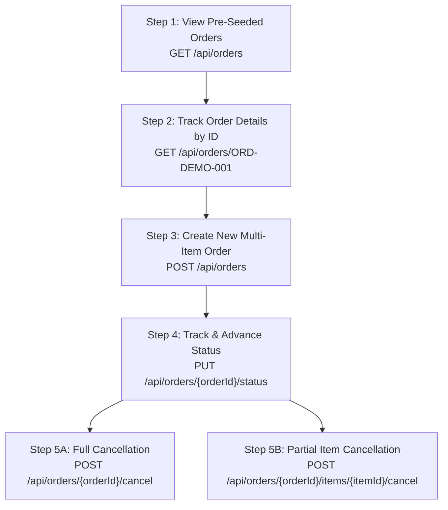

# Swagger Testing Journey: View Order to Track Order

This document provides a step-by-step walkthrough for testing the **Order Processing System** using the interactive **Swagger UI**. Every endpoint comes pre-configured with **working, executable input requests** so you can execute the full order lifecycle without typing JSON payloads from scratch.

---

## 1. Quick Access Links

| Service | Port | Swagger UI URL | Raw OpenAPI JSON Spec |
| :--- | :--- | :--- | :--- |
| **Order Service** | `8080` | [http://localhost:8080/swagger-ui.html](http://localhost:8080/swagger-ui.html) | [http://localhost:8080/v3/api-docs](http://localhost:8080/v3/api-docs) |
| **Inventory Service** | `8081` | [http://localhost:8081/swagger-ui.html](http://localhost:8081/swagger-ui.html) | [http://localhost:8081/v3/api-docs](http://localhost:8081/v3/api-docs) |
| **Payment Service** | `8082` | [http://localhost:8082/swagger-ui.html](http://localhost:8082/swagger-ui.html) | [http://localhost:8082/v3/api-docs](http://localhost:8082/v3/api-docs) |

---

## 2. Testing Journey Overview



---

## 3. Step-by-Step Interactive Walkthrough

### Step 1: View All Orders (or Filter by Status)
- **Service**: Order Service (`http://localhost:8080/swagger-ui.html`)
- **Method & Path**: `GET /api/orders`
- **Pre-populated Inputs in Swagger**:
  - `status`: `PENDING`
  - `page`: `0`
  - `size`: `20`
- **Action**:
  1. Expand `GET /api/orders`.
  2. Click **"Try it out"**.
  3. Click **"Execute"**.
- **Expected Result**:
  HTTP `200 OK`. Returns the pre-seeded demo order `ORD-DEMO-001` with its customer details, total amount, and active items.

---

### Step 2: Track Order Details by ID
- **Service**: Order Service (`http://localhost:8080/swagger-ui.html`)
- **Method & Path**: `GET /api/orders/{orderId}`
- **Pre-populated Inputs in Swagger**:
  - `orderId`: `ORD-DEMO-001`
- **Action**:
  1. Expand `GET /api/orders/{orderId}`.
  2. Click **"Try it out"**.
  3. Notice `orderId` is already filled with `ORD-DEMO-001`.
  4. Click **"Execute"**.
- **Expected Result**:
  HTTP `200 OK` with full tracking information:
  ```json
  {
    "success": true,
    "message": "Success",
    "data": {
      "id": "ORD-DEMO-001",
      "customerId": "CUST-ALICE",
      "status": "PENDING",
      "totalAmount": 2898.00,
      "items": [
        {
          "id": "ITEM-DEMO-001",
          "itemCodeId": "ITEM-101",
          "itemName": "MacBook Pro 16\"",
          "quantity": 1,
          "pricePerUnit": 2499.00,
          "status": "ACTIVE"
        },
        {
          "id": "ITEM-DEMO-002",
          "itemCodeId": "ITEM-102",
          "itemName": "Sony WH-1000XM5 Headphones",
          "quantity": 1,
          "pricePerUnit": 399.00,
          "status": "ACTIVE"
        }
      ],
      "createdAt": "2026-10-04T15:45:00Z",
      "updatedAt": "2026-10-04T15:45:00Z"
    }
  }
  ```

---

### Step 3: Create a New Multi-Item Order
- **Service**: Order Service (`http://localhost:8080/swagger-ui.html`)
- **Method & Path**: `POST /api/orders`
- **Pre-populated Inputs in Swagger**:
  - `Idempotency-Key` (Header): `JOURNEY-IDEMP-KEY-101`
  - Request Body:
    ```json
    {
      "customerId": "CUST-ALICE",
      "paymentMethod": "CREDIT_CARD",
      "items": [
        {
          "itemCodeId": "ITEM-101",
          "quantity": 1
        },
        {
          "itemCodeId": "ITEM-102",
          "quantity": 2
        }
      ]
    }
    ```
- **Action**:
  1. Expand `POST /api/orders`.
  2. Click **"Try it out"**.
  3. The body is already filled with real seeded items (`ITEM-101` and `ITEM-102`).
  4. Click **"Execute"**.
- **Expected Result**:
  HTTP `201 Created`. The order is created with status `PENDING`, items are reserved in `inventory-service`, and payment is authorized in `payment-service`.
  *(Copy the generated `id` value from the response for the next steps).*

---

### Step 4: Advance & Track Order Status Transitions
- **Service**: Order Service (`http://localhost:8080/swagger-ui.html`)
- **Method & Path**: `PUT /api/orders/{orderId}/status`
- **Pre-populated Inputs in Swagger**:
  - `orderId`: `ORD-DEMO-001` (or your newly created order ID from Step 3)
  - Select any of the pre-configured examples from the dropdown:

#### Example 4A: Advance to `PROCESSING`
```json
{
  "status": "PROCESSING",
  "reason": "Payment verified and order accepted for fulfillment"
}
```

#### Example 4B: Advance to `SHIPPED` (Live Courier Tracking)
```json
{
  "status": "SHIPPED",
  "reason": "Dispatched via Express Courier (Tracking: EXP-998877)"
}
```

#### Example 4C: Advance to `DELIVERED`
```json
{
  "status": "DELIVERED",
  "reason": "Successfully delivered to customer residence"
}
```

- **Action**:
  1. Expand `PUT /api/orders/{orderId}/status`.
  2. Click **"Try it out"**.
  3. Select an example payload and click **"Execute"**.
  4. Re-run `GET /api/orders/{orderId}` to verify the updated status.
  *(Note: Orders in `PENDING` also advance to `PROCESSING` automatically via the 5-minute background job).*

---

### Step 5A: Full Order Cancellation (Allowed ONLY in `PENDING`)
- **Service**: Order Service (`http://localhost:8080/swagger-ui.html`)
- **Method & Path**: `POST /api/orders/{orderId}/cancel`
- **Pre-populated Inputs in Swagger**:
  - `orderId`: `ORD-DEMO-001`
- **Action**:
  1. Expand `POST /api/orders/{orderId}/cancel`.
  2. Click **"Try it out"**.
  3. Click **"Execute"**.
- **Expected Result**:
  HTTP `200 OK`. The order transitions to `CANCELLED`, all items transition to `CANCELLED`, and inventory stock is automatically refunded/restored.
  *(If the order has already moved to `PROCESSING` or `SHIPPED`, the system correctly returns HTTP `400 Bad Request` enforcing the problem statement rule).*

---

### Step 5B: Partial Item Cancellation (Allowed ONLY in `PENDING`)
- **Service**: Order Service (`http://localhost:8080/swagger-ui.html`)
- **Method & Path**: `POST /api/orders/{orderId}/items/{itemId}/cancel`
- **Pre-populated Inputs in Swagger**:
  - `orderId`: `ORD-DEMO-001`
  - `itemId`: `ITEM-DEMO-002`
- **Action**:
  1. Expand `POST /api/orders/{orderId}/items/{itemId}/cancel`.
  2. Click **"Try it out"**.
  3. Click **"Execute"**.
- **Expected Result**:
  HTTP `200 OK`. Item `ITEM-DEMO-002` (Headphones) is marked `CANCELLED`, the order total amount recalculates down to \$2,499.00, and 1 unit is released back to stock.

---

## 4. Supporting Services Verification

### Inventory Catalog (`http://localhost:8081/swagger-ui.html`)
- **Endpoint**: `GET /api/items`
- **Action**: Click **"Try it out" ➔ "Execute"** to view live stock quantities for:
  - `ITEM-101`: MacBook Pro 16" (Stock: 50, Price: \$2,499.00)
  - `ITEM-102`: Sony WH-1000XM5 Headphones (Stock: 100, Price: \$399.00)
  - `ITEM-103`: Logitech MX Master 3S Mouse (Stock: 75, Price: \$99.00)
  - `ITEM-104`: Dell UltraSharp 27" 4K Monitor (Stock: 30, Price: \$649.00)
  - `ITEM-SINGLE`: Limited Edition Item (Stock: 1, Price: \$999.00)

### Payment Simulator Controls (`http://localhost:8082/swagger-ui.html`)
- **Endpoint**: `PUT /api/payments/config`
- **Action**: Toggle payment gateway outcome with zero downtime:
  - To simulate failure (testing circuit breaker & compensation rollback):
    ```json
    {
      "result": "FAILURE",
      "delayMs": 0
    }
    ```
  - To restore successful processing:
    ```json
    {
      "result": "SUCCESS",
      "delayMs": 0
    }
    ```
